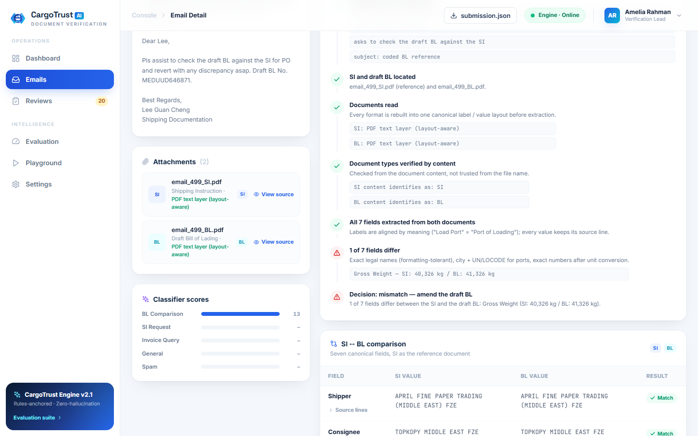
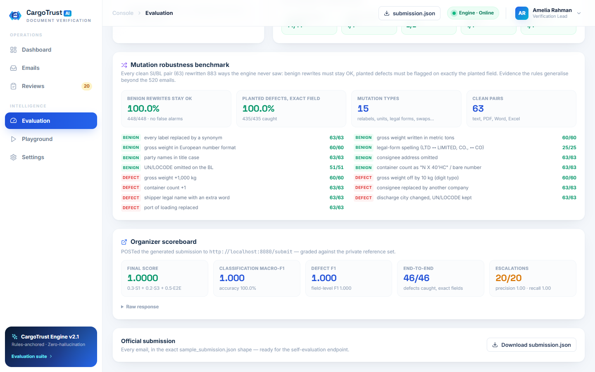

# CargoTrust AI — Shipping Document Verification

**From email inbox to discrepancy report.** CargoTrust AI reads a shipping operations inbox, sorts
document-check requests from SI requests, invoice queries, general mail and spam, reads the
**Shipping Instruction (SI)** and draft **Bill of Lading (BL)** in whatever format they arrive — text,
PDF, scanned PDF, Word, Excel — compares the seven critical shipment fields, and drafts the reply.
When it cannot decide reliably, it escalates to a human with the reason and the evidence instead of
guessing.

Built for the **Averis × Monash Hackathon 2026** problem statement *"Shipping document verification —
from email inbox to discrepancy report"* ([docs/problem-statement.pdf](docs/problem-statement.pdf)).
The official 520-email participant dataset ships in [`dataset/`](dataset/), so the console runs on
real data out of the box.



## Results

| Check | Result |
| --- | --- |
| **Organizers' scorer** (`score_cli.py`, 520 emails) | **1.0000** final · classification macro-F1 1.000 · defect F1 1.000 · **46/46** defects caught with the exact fields · **20/20** escalations, 0 extra |
| **Mutation robustness** (rewritten documents the engine never saw) | **448/448** benign rewrites stay clean · **435/435** planted defects flagged on exactly the planted field |
| Self-test suite (labeled synthetic cases) | 19/19 end-to-end |

The score is reproducible: `npm run score` (see [Reproduce the numbers](#reproduce-the-numbers)).

**How the score was earned.** The organizers' scorer was used only the way participants use the
`/submit` endpoint: submit, read the aggregate scoreboard. The per-email answer key and the
organizers' data generator were never read. Every rule targets a general pattern (body intent over
subject, label synonyms, units, legal forms, placeholders), and the mutation benchmark exists to show
those rules hold on documents outside the dataset.

## Quick start

```bash
npm install
npm run dev        # → http://localhost:3000
```

* First boot runs the engine over the shipped 520 emails and stores results in `data/db.json`
  (git-ignored). OCR results for scanned PDFs are cached in `data/cache/`.
* Sign in with any username and password (demo auth).
* Public pages: `/` (landing) and `/try` (playground). Console: `/dashboard`.

Production build: `npm run build && npm start`. Requires Node 18.18+.

## What it does

| Stage | How |
| --- | --- |
| **Classify** | The body is cleaned to the newest message (no security banner, quoted thread or signature) and scored by intent. **Body intent outranks the subject**, so a misleading subject cannot reroute an email. Spam and phishing are screened first: a scam about "invoice payment" is spam, not an invoice query. An attached SI + BL pair is structural proof of a check request. |
| **Read** | Formats are detected from the bytes, not the extension. Every document is rebuilt into one canonical `Label: value` layout: PDFs from page geometry (column anchors keep long labels apart from values; container tables become rows), Word tables with their soft line breaks, Excel label/value rows. **Scanned PDFs are read with OCR** (Tesseract) and cached. |
| **Extract** | Labels are aligned by meaning: "Port of Loading", "Load Port", "POL" and "PORT OF LOADING (装货港)" all land in one field. Multi-line party blocks keep the name separate from the address. Container count and gross weight fall back to the container table (count rows, sum weights). **Placeholders** ("TBA", "N/A", "____MT") are never treated as values. |
| **Verify** | Document type is checked from the content, not the file name. A commercial invoice, packing list or certificate of origin is rejected. If the SI and BL files are named the wrong way round, they are swapped back. |
| **Compare** | SI is the reference. **Party names must match exactly**: only formatting may differ (case, punctuation, LTD/LIMITED, CO./COMPANY). "APRIL FINE PAPER TRADING" and "… (MIDDLE EAST) FZE" are different companies. Ports must agree on city, and on UN/LOCODE when both carry one; the hardest planted trap keeps the code and swaps the city. Numbers must match exactly after unit conversion (21.577 MT = 21,577 kg, EU number formats handled). |
| **Decide** | `OK` · `MISMATCH` with the exact fields, shown as *SI: 3 / BL: 4* · `NEEDS_REVIEW` with a reason: `missing_attachment`, `unreadable`, `wrong_doc_type` or `missing_value`. |
| **Explain & act** | Every email gets a **decision trace** (each step, its evidence and its outcome) and a **draft reply**: an amendment request listing SI vs BL values, a confirmation, or a request for the missing or unreadable document. Every value in the draft comes from the comparison. |
| **Ask for help** | Every escalation becomes a review case with the reason, the evidence and per-field correction inputs. A correction re-runs the comparison and updates the report. |

### Judgment calls

* **A thread that only asks someone to *send* the draft BL** ("Please assist to send the draft BL for
  checking") has nothing to compare yet. It is routed as a BL thread and tracked as *awaiting
  documents*, not escalated. `missing_attachment` is used only when the sender asks for a comparison
  and the documents are missing.
* **Scans are read but not trusted.** OCR produces a pre-check (values and a preliminary comparison)
  and the case goes to a human as `unreadable`. OCR misreads characters ("6 x 40'HC" read as
  "§ x 40'HC"), so releasing on OCR alone would create false alarms.
* **Addresses are not compared.** Documents legitimately omit them. Every planted defect is in the
  party name.
* **A team-wide SLA reminder** ("submit SI & AED for all pending shipments") is GENERAL, not an
  SI request about a specific shipment.

## The console

| Route | What you'll find |
| --- | --- |
| `/` | Landing page: problem, pipeline, features, results, screenshots. |
| `/try` | **Public playground.** Upload any SI and BL (text, PDF, scanned PDF, Word, Excel), or load a real dataset case, and the production pipeline checks them live with the trace and the draft reply. Nothing is stored. |
| `/dashboard` | Aggregates computed from the processed inbox, pipeline flow, defect histogram, needs-attention list. |
| `/emails` | Classified inbox with filters and search. |
| `/emails/[id]` | Decision trace, SI ↔ BL comparison with source lines, how each attachment was read, source viewer with the lines the engine used highlighted, draft reply, review case. |
| `/reviews` | Human-review queue: evidence, per-field corrections, approve / correct / reject. |
| `/evaluation` | Self-test suite, **mutation robustness benchmark**, and one-click grading against the organizers' SDOC server with the scoreboard shown as tiles. |
| `/settings` | SDOC server URL, reset & reprocess the dataset. |



## Reproduce the numbers

```bash
npm run engine       # process all 520 emails offline → out/submission.json, out/results.json
npm run robustness   # mutation benchmark over every clean pair → out/robustness.json
npm run score        # engine + organizers' score_cli.py (needs the organizer kit, below)
```

`npm run score` expects the organizers' Docker kit (`sdoc-hackathon-docker.zip` from the problem
statement folder) unzipped into `.local/sdoc-docker/`. `.local/` is git-ignored because the kit
contains the private answer key, which must never be committed. To grade from the console instead,
run the kit's server (`docker compose up --build`, port 8080) and press **Score vs SDOC server** on
`/evaluation`.

## Architecture

```text
.
├── dataset/                      # official SDOC participant bundle (inbox/, attachments/, loader.py)
├── docs/problem-statement.pdf    # the SDOC problem statement
├── public/screens/               # screenshots
├── scripts/
│   ├── run-engine.ts             # offline run → out/
│   ├── robustness.ts             # mutation benchmark → out/
│   └── score.sh                  # grade with the organizers' scorer in .local/
└── src/
    ├── app/
    │   ├── page.tsx · try/ · login/
    │   ├── (console)/            # dashboard/ emails/ emails/[id]/ reviews/ evaluation/ settings/
    │   └── api/                  # typed route handlers (the backend)
    │       ├── emails | emails/[id] | emails/[id]/source
    │       ├── reviews | reviews/[id]
    │       ├── evaluation        # self-test · robustness · POST /submit proxy
    │       ├── try | try/sample  # playground (multipart upload) · sample files
    │       └── metrics · submission · settings · seed · auth
    ├── components/               # shell, UI kit, decision trace + draft reply views
    ├── data/taxonomy.ts          # categories, statuses, field keys, labels
    └── lib/
        ├── dataset.ts            # dataset loader + cached document reads
        ├── store.ts              # JSON persistence in data/db.json
        ├── metrics.ts · submission.ts
        └── engine/
            ├── classify.ts       # body cleaning, spam screen, intent scoring, document intent
            ├── readers.ts        # byte sniffing; PDF geometry, OCR, DOCX, XLSX → canonical layout
            ├── extract.ts        # label dictionary, blocks, table fallback, placeholders, doc type
            ├── normalize.ts      # legal names, ports + UN/LOCODE, units, number formats
            ├── compare.ts        # 7-field comparator
            ├── pipeline.ts       # classify → read → extract → verify → compare → decide
            ├── trace.ts          # step-by-step decision trace
            ├── reply.ts          # draft amendment / confirmation / information request
            ├── review.ts         # review-case builder
            ├── robustness.ts     # mutation benchmark
            └── selftest.ts       # labeled synthetic suite
```

### Design decisions

* **No LLM in the decision path.** Shipping documents are structured enough that deterministic rules
  are more accurate *and* auditable. Every value traces back to a source line, and the same input
  always gives the same answer.
* **One canonical layout.** Each reader solves layout once; extraction, evidence highlighting and the
  source viewer all work on the same text.
* **Escalate, never guess.** A crash, a placeholder, an OCR read or a missing document can never
  produce `OK`.
* **JSON file store.** Zero-config persistence for a demo. Every consumer goes through
  `getDB()` / `mutate()`, so moving to Postgres is a single-module change.

## API reference

| Method | Route | Purpose |
| --- | --- | --- |
| POST | `/api/auth/login` · `/api/auth/logout` | demo session |
| GET | `/api/emails?q&category&status&page` | filtered inbox (paged) |
| GET · POST | `/api/emails/[id]` | full result · reprocess one email |
| GET | `/api/emails/[id]/source?att=` | canonical text of one attachment (what the engine read) |
| GET | `/api/reviews` | open + resolved review cases |
| POST | `/api/reviews/[id]` | resolve: `approve` \| `correct` (+edits) \| `reject` |
| GET | `/api/metrics` | dashboard aggregates |
| GET · POST | `/api/evaluation` | runs · `{action:"run"}` self-test · `{action:"robustness"}` · `{action:"score"}` organizer scoring |
| POST | `/api/try` | multipart `si`, `bl` (files) or `siText`, `blText`; optional `subject`, `body` → result, trace, reply |
| GET | `/api/try/sample?file=` | a dataset attachment, for the playground's sample buttons |
| GET | `/api/submission` | official-format `submission.json` |
| GET · PUT | `/api/settings` | console preferences |
| POST | `/api/seed` | reset & reprocess the dataset |

## Dataset

[`dataset/`](dataset/) is the official participant bundle: 520 JSON inbox records, 250 attachments
(192 text, 28 PDF including 6 image-only scans and 2 corrupt files, 22 Excel, 8 Word),
`sample_submission.json` and the organizers' `loader.py`.

## Limitations

* OCR quality on degraded scans is limited, which is why OCR reads always go to a human. A
  vision-capable LLM reading the scan alongside OCR would improve the pre-check.
* Demo authentication: any credentials sign in. There are no per-user roles.
* The JSON store suits a single instance. Use a database for multi-user deployments.
* Results are measured on the organizers' synthetic dataset plus mutations of it. Real inboxes will
  bring new label spellings; adding them to the label dictionary in `extract.ts` is a one-line change.

## Credits

* Problem statement and dataset: Averis × Monash Hackathon 2026 / SDOC organizers.
  `src/lib/dataset.ts` mirrors the semantics of their `dataset/loader.py`.
* Peer submissions for the same problem, studied while building:
  [ShipDoc / Player 4 Not Found](https://github.com/Hackathon-Repo-Org/Shipping-Document-Verification-System-Averis_x_Monash_Hackathon)
  (try-it-yourself page, evidence linked to the source document),
  [SHIPDOC / Team Claude's Plan](https://github.com/VRP2206/Averis_hackathon_2026),
  [shipdoc-verifier2](https://github.com/bil21071/shipdoc-verifier2) (advanced-format parsing),
  [SIBLIX](https://siblix.vercel.app/), [ClearDraft](https://cleardraft-one.vercel.app/),
  [WayboxAI](https://wayboxai.vercel.app/) and [DraftWise](https://draft-wise-gold.vercel.app/)
  (guided demo, labelled provenance).

## License

MIT — see [LICENSE](LICENSE).
