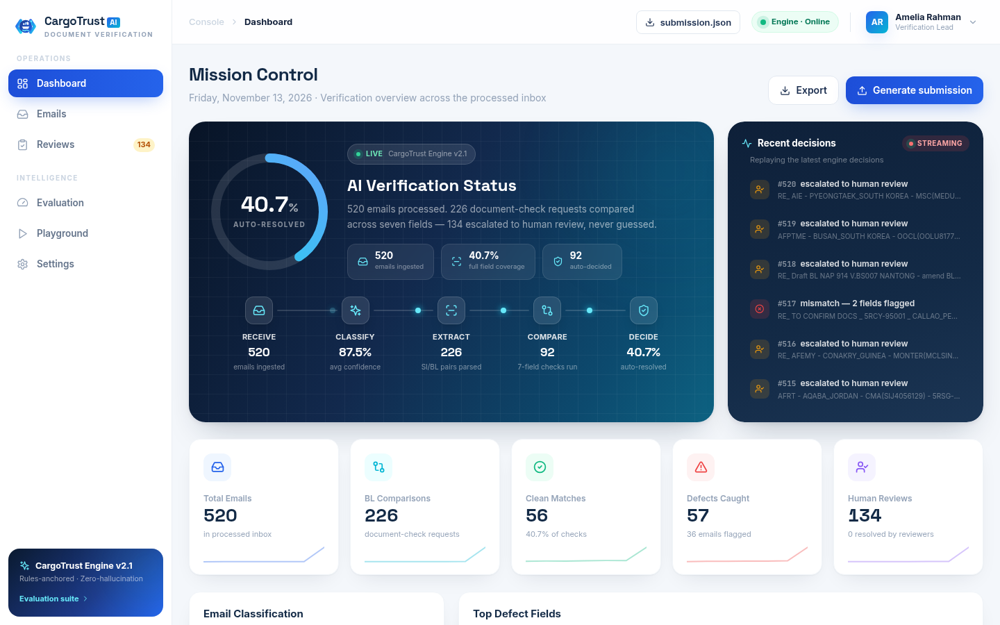
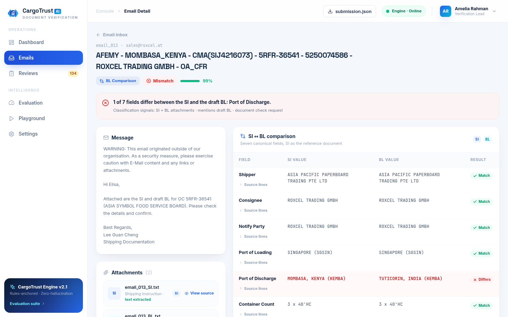

# CargoTrust AI — Intelligent Shipping Document Verification

**From email inbox to discrepancy report.** CargoTrust AI reads a shipping operations inbox, tells
document-check requests apart from SI submissions, invoice queries, general mail and spam, extracts the
seven critical shipment fields from each **Shipping Instruction (SI)** and draft **Bill of Lading (BL)**,
and catches discrepancies before the draft is finalized — escalating to a human instead of guessing
whenever it cannot decide.

Built as a full-stack submission for the **SDOC hackathon problem statement** *“Shipping document
verification — from email inbox to discrepancy report”*. The official 520-email participant dataset ships
inside this repo (`dataset/`), so the console runs on real data out of the box.



---

## Quick start

```bash
npm install
npm run dev        # → http://localhost:3000
```

* First boot runs the engine over the shipped 520-email dataset and persists results to `data/db.json`.
* Sign in with **any username + password** (demo auth), or the **Continue with Google** button.
* Landing page: `/` · Console: `/dashboard`.

Production build: `npm run build && npm start`.

## What it does

| Capability | How |
|---|---|
| **Classify** | Weighted-intent scoring into `BL_COMPARISON`, `SI_REQUEST`, `INVOICE_QUERY`, `GENERAL`, `SPAM`. Attachment structure (an SI + BL pair) is the strongest signal; keywords, sender reputation and style heuristics cover misleading subjects. |
| **Extract** | Label-variant extraction of the 7 canonical fields from SI/BL text — `Load Port` / `POL` / `Port of Loading (POL)` all land in the same slot. Every value keeps its exact source line as evidence. |
| **Normalize** | Units → kg (`22 MT ≡ 22,000 KG`), legal suffixes (`MOORIM SP CO., LTD ≡ MOORIM SP CO LTD`) via core-token containment, ports via UN/LOCODE + name compatibility, address continuation lines skipped. |
| **Compare** | Type-aware 7-field comparison. Exact numeric equality on counts/weights — **never fuzzy on numbers**. Catches the planted hard cases: same fake LOCODE with a changed city (`MOMBASA (KEMBA)` vs `TUTICORIN (KEMBA)`). |
| **Decide** | `OK` (all 7 match) · `MISMATCH` (≥1 field differs, reported as `SI: 3 / BL: 4`) · `NEEDS_REVIEW` with reason `missing_attachment` \| `unreadable` \| `wrong_doc_type` \| `missing_value`. |
| **Ask for help** | Every escalation becomes a review case with the reason, the recovered evidence and per-field correction inputs. Corrections recompute the comparison and update the report — full audit trail. |
| **Advanced formats** | PDF text layers, Excel sheets and Word documents are parsed into the same pipeline (`pdf-parse` / SheetJS / `mammoth` + a visual-order line-joiner for boxed layouts); image-only scans stay `unreadable` → escalated, never silently mis-parsed. |

## The console

| Route | What you'll find |
|---|---|
| `/` | Landing page: problem, solution, pipeline, features, screenshots, tech. |
| `/dashboard` | Mission control — aggregates computed from the processed inbox, pipeline flow, live decision replay, defect histogram, needs-attention list. |
| `/emails` | The classified inbox: filters, search, pagination, per-email results. |
| `/emails/[id]` | Email drill-down: SI ↔ BL comparison table with evidence lines, per-attachment **source viewer** (the parsed document text with the lines the engine used highlighted), classifier scores, review case. |
| `/reviews` | Human-in-the-loop queue: evidence panels, per-field corrections, approve / correct / reject. |
| `/try` | **Public playground** — paste any SI + BL text and run the real extractor + comparator live. Nothing is stored. |
| `/evaluation` | Self-test harness (labeled synthetic suite) + one-click scoring against the SDOC server. |
| `/settings` | Engine preferences, SDOC server URL, reset & reprocess dataset. |



## Evaluation without ground truth

The organizers keep the reference answers private, so the repo ships a **labeled self-test suite**
(`src/lib/engine/selftest.ts`) covering every category, defect type, normalization trap and escalation
reason. **Evaluation → Run self-test** computes:

* classification accuracy (per category),
* decision accuracy + defect precision / recall / F1 (field-level),
* escalation reliability (missed escalations vs false alarms),
* end-to-end correctness (category + status + exact defect fields).

Current suite result: **19/19 end-to-end · 100% classification · defect F1 1.00 · 4/4 escalations.**
Every run is persisted and charted over time.

**Official scoring path:** Evaluation → *Score vs SDOC server* POSTs the generated submission to the
organizer server (`POST {sdocServerUrl}/submit`), and **Download submission.json** (console header)
produces the exact `sample_submission.json` shape — one entry per email:

```json
{
  "email_013": {
    "category": "BL_COMPARISON",
    "status": "MISMATCH",
    "review_reason": null,
    "defect_fields": ["port_of_discharge"],
    "has_defect": true
  }
}
```

## Architecture

```
.
├── dataset/                      # official SDOC participant bundle (inbox/, attachments/, loader.py)
├── docs/problem-statement.pdf    # the SDOC problem statement
├── public/                       # favicon + landing-page screenshots
└── src/
    ├── app/
    │   ├── page.tsx              # landing (server component)
    │   ├── login/                # demo auth (any credentials)
    │   ├── try/                  # public SI + BL playground
    │   ├── (console)/            # auth-guarded app shell
    │   │   └── dashboard/ emails/ emails/[id]/ reviews/ evaluation/ settings/
    │   └── api/                  # typed route handlers (the backend)
    │       ├── auth/login | logout
    │       ├── emails | emails/[id] | emails/[id]/source   # list · detail · reprocess · parsed source
    │       ├── reviews | reviews/[id]                      # queue · approve/correct/reject
    │       ├── metrics                                     # dashboard aggregates
    │       ├── evaluation                                  # self-test runs · POST /submit proxy
    │       ├── submission                                  # official-format download
    │       ├── try                                         # stateless playground run
    │       └── settings · seed
    ├── components/               # shell, auth gate, icon set, UI kit (SVG charts, toasts)
    ├── data/taxonomy.ts          # categories, statuses, field keys, labels
    ├── types/                    # ambient module types (pdf-parse)
    └── lib/
        ├── dataset.ts            # SDOC inbox/attachments loader (mirrors loader.py)
        ├── store.ts              # JSON persistence in data/db.json (swap for Prisma/Postgres)
        ├── metrics.ts            # aggregates + self-test runner
        ├── submission.ts         # official submission builder
        └── engine/
            ├── classify.ts       # weighted-intent classifier
            ├── binary.ts         # PDF / XLSX / DOCX text extraction + line joiner
            ├── extract.ts        # label-variant field extraction
            ├── normalize.ts      # units · legal names · ports (LOCODE-aware)
            ├── compare.ts        # 7-field, type-aware comparator
            ├── pipeline.ts       # classify → extract → compare → decide
            ├── review.ts         # escalation case builder
            └── selftest.ts       # labeled evaluation suite
```

`data/db.json` is generated on first boot and is git-ignored.

**Design decisions**

* **Zero-hallucination by design** — the decision path is deterministic rules over plain text; no LLM in
  the loop, so every value is auditable back to its source line. OCR / vision-LLM extraction can be
  plugged into the same pipeline interface later without touching decision logic.
* **Reliability over bravado** — PDF/XLSX/DOCX attachments (the advanced stage) are parsed into the same
  pipeline; anything that yields no usable text (image-only scans) is routed to review as `unreadable`
  rather than silently mis-parsed. The review console then makes the human step fast (per-field
  corrections with the recovered evidence side-by-side).
* **Client-side auth gate** — the console is guarded by `components/authGate.tsx` (demo session in
  localStorage plus cookie), not middleware, so it works behind preview proxies that drop cookies.
* **JSON file store** — zero-config persistence for the hackathon; every consumer goes through
  `getDB()/mutate()`, so swapping in a real database is a single-module change.

## API reference

| Method | Route | Purpose |
|---|---|---|
| POST | `/api/auth/login` · `/api/auth/logout` | demo session cookie |
| GET | `/api/emails?q&category&status&page` | filtered inbox (paged) |
| GET · POST | `/api/emails/[id]` | full result · reprocess one email |
| GET | `/api/reviews` | open + resolved review cases |
| POST | `/api/reviews/[id]` | resolve: `approve` \| `correct` (+edits) \| `reject` |
| GET | `/api/metrics` | dashboard aggregates |
| GET · POST | `/api/evaluation` | runs history · `{action:"run"}` self-test · `{action:"score"}` SDOC scoring |
| GET | `/api/submission` | official-format `submission.json` |
| GET · PUT | `/api/settings` | console preferences |
| POST | `/api/seed` | reset & reprocess the dataset |

## Dataset

`dataset/` is the official SDOC participant bundle (520 JSON inbox records + 250 attachments +
`sample_submission.json` + `loader.py`). 126 emails carry attachments (192 txt, plus PDF/XLSX/DOCX in the
harder tail); the 500-series exercises wrong document types, unreadable scans and missing values.

## Roadmap

IMAP / Microsoft Graph ingestion · OCR + vision-LLM extraction for scanned PDFs (routing unchanged —
they already escalate) · table-aware XLSX/DOCX parsing · Prisma/Postgres store · reviewer-correction learning
loop · carrier API integrations.

## Credits

* Problem statement & dataset: SDOC hackathon organizers (see `dataset/loader.py` for their reference
  loader — the repo's `src/lib/dataset.ts` mirrors its semantics on the server).
* Same problem space, great reference build: [SIBLIX](https://github.com/Mahiamk/SIBLIX)
  ([live](https://siblix.vercel.app/)) — their README informed the normalizer/comparator design here.
* Peer submissions studied while building (same problem statement & data) — patterns borrowed where
  noted: [ShipDoc / Player 4 Not Found](https://github.com/Hackathon-Repo-Org/Shipping-Document-Verification-System-Averis_x_Monash_Hackathon)
  (try-it-yourself page, evidence → source document), [Sentinel / DuoCode](https://github.com/TCF1209/duocode-sentinel)
  (evidence-first framing), [ZeroDay](https://github.com/Dkkama/ZeroDay), [DraftWise](https://github.com/TEE123754/DraftWise)
  ([live](https://draft-wise-gold.vercel.app/)), [shipdoc-verifier2](https://github.com/bil21071/shipdoc-verifier2)
  (advanced-format parsing), [SHIPDOC / Team Claude's Plan](https://github.com/VRP2206/Averis_hackathon_2026).
