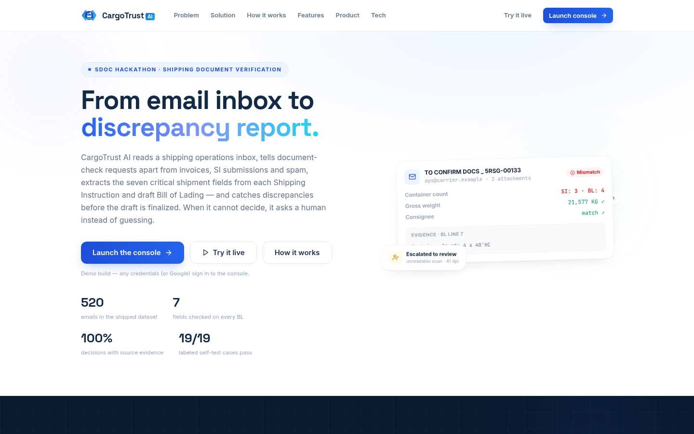
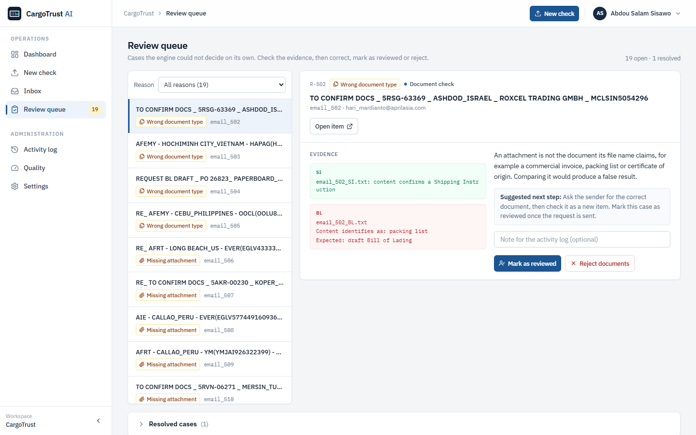
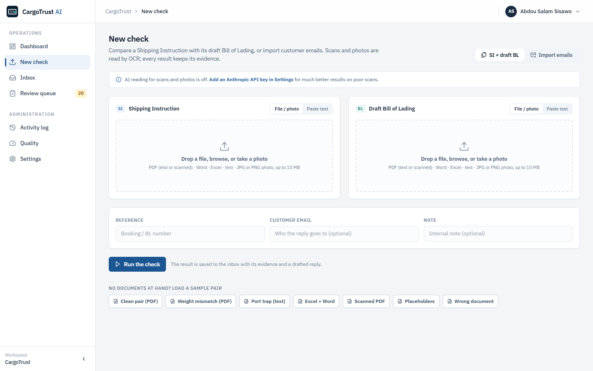

<h1 align="center">CargoTrust AI</h1>

<p align="center"><b>Shipping document verification: every Shipping Instruction checked against its draft Bill of Lading before the BL is issued.</b></p>

<p align="center">
  <a href="https://cargotrust-ai.vercel.app"></a>
  <a href="#proven-not-claimed"></a>
  <a href="#proven-not-claimed"></a>
  <a href="#proven-not-claimed"></a>
  <a href="https://github.com/AbdouSalamSisawo/CargoTrust-AI-Shipping-Verifier/commits/main"></a>
  <a href="LICENSE"></a>
</p>
<p align="center">
  
  
  
  
  
  
  
  
</p>

<p align="center">
  <a href="https://cargotrust-ai.vercel.app/login"><b>Live demo</b></a> (read-only: <b>Explore the read-only demo</b> on the sign-in page, or <code>demo@cargotrust.local</code> / <code>cargotrust-demo-2026</code>)
</p>
<p align="center">
  <a href="#two-deployments">Deployments</a> ·
  <a href="#proven-not-claimed">Results</a> ·
  <a href="#screens">Screens</a> ·
  <a href="#architecture">Architecture</a>
</p>



CargoTrust reads customer emails and documents in whatever format they arrive (text, PDF, Word,
Excel, scanned PDFs and phone photos), compares the seven fields that cause costly BL amendments, and
drafts the reply to the customer. When it cannot decide reliably, it sends the case to a person with
the reason and the evidence instead of guessing.

## Where the project stands

| Area | Status |
| --- | --- |
| **Verification engine** | Complete. Scores 1.0000 on the Averis × Monash 2026 benchmark and passes all 883 mutation tests (see [results](#proven-not-claimed)). |
| **Console** | Complete for a documentation desk: new checks, `.eml` import, inbox, decision trace, review queue, CSV export, accounts with three roles, activity log, settings. |
| **Demo deployment** | **Live** at <https://cargotrust-ai.vercel.app>: Vercel, Neon Postgres and a private Blob store, all in Frankfurt. Sign-in, text, Word, Excel and scanned-PDF checks verified on the live site. Visitors get a read-only demo account. |
| **On-premise deployment** | Docker image and Compose file for an organisation's own server. The same code runs and is tested on Node locally; the Docker image itself has not yet been built and verified on a Docker host. |
| **AI reading** | Built and tested offline (`npm run check:ai`). Switched on per organisation with its own Anthropic API key; off on the public demo. |
| **Next** | Live mailbox connection (IMAP / Microsoft 365), single sign-on, a pilot on real documents. |

## Why it matters

A wrong consignee, port or weight on a Bill of Lading means amendment fees, delayed release and
cargo held at the port. Documentation desks check these by eye, document by document, across
hundreds of emails a day. CargoTrust does the reading and comparison in seconds and leaves people
the decisions that need judgement.

## What it does

| Stage | How |
| --- | --- |
| **Intake** | Upload an SI and draft BL (any format, including a photo taken on a phone), or import customer emails saved as `.eml` from Outlook or Gmail. SI and BL attachments are found by file name or, when the name says nothing ("scan0042.pdf"), by their content. |
| **Classify** | Each email is sorted into document check, SI request, invoice query, general or spam. The body outranks the subject, so a misleading subject cannot reroute an email; phishing is screened first. |
| **Read** | The format is detected from the bytes. PDFs are rebuilt from page geometry, Word tables keep their line breaks, Excel keeps label/value rows. **Scans and photos are read by OCR and, when enabled, by Claude's vision model** (see below). |
| **Extract** | "Port of Loading", "Load Port", "POL" and "PORT OF LOADING (装货港)" land in one field. Placeholders ("TBA", "____MT") are never treated as values. Totals fall back to the container table. |
| **Compare** | SI is the reference. Company names must match exactly apart from formatting (an extra word is a different company). Ports must agree on city and UN/LOCODE. Numbers must match exactly after unit conversion (21.577 MT = 21,577 kg). |
| **Decide** | **Match** (`OK`) · **Discrepancy** (`MISMATCH`) with the exact fields (*SI: 6 / BL: 5*) · **Needs review** (`NEEDS_REVIEW`) with a reason: missing attachment, unreadable or scanned document, wrong document type, or missing value. |
| **Act** | Every item gets a step-by-step **decision trace**, the source line behind every value, and a **drafted reply** (amendment request, confirmation, or request for the missing document) that opens in the operator's mail app. |
| **Review** | Escalations go to a review queue where an operator approves, rejects or corrects values; corrections re-run the comparison. |

## AI reading for scans and photos

Image-only PDFs and phone photos have no text layer. OCR reads them poorly: on a clean photo,
Tesseract still turns `APRIL FAR EAST (M) SDN BHD` into `(M) SDN BHD` and misses the weight.

With an Anthropic API key, CargoTrust sends the page images to **Claude (`claude-haiku-5-5` by
default; `claude-opus-5-5` for the most accurate reads of badly degraded scans)**, which transcribes the document into the same `Label: value` layout the other readers produce. The model is
told to copy exactly what is printed and never correct, normalise or complete a value, and to mark
anything it cannot read. The transcription then goes through the **same deterministic extractor and
comparator**; the AI never decides whether documents match. OCR still runs as an independent
cross-check, and the console shows where the two agree.

An administrator chooses what happens next:

* **A human confirms** (default): every scan goes to the review queue with the AI pre-check filled in.
* **Decide automatically when clear**: if the AI read every field clearly, the scan is decided like a
  text PDF; anything marked unclear still goes to a person.

Only page images of scans are sent to the API. Text PDFs, Word and Excel files are read locally.
Each organisation uses its own API key (Settings → AI reading, or `ANTHROPIC_API_KEY`), so usage is
billed to its own Anthropic account and its documents go through its own data agreement.
Without a key, everything works; scans are read by OCR and always go to a person.
`npm run check:ai` tests this decision path offline, without a key.

## Accounts, roles and audit trail

* Email and password sign-in. Passwords are hashed with scrypt; sessions are HMAC-signed cookies.
* Roles: **admin** (users, settings, workspace data), **operator** (submit documents, import email,
  resolve reviews), **viewer** (read-only).
* New users get a temporary password and must change it on first sign-in. Repeated failed sign-ins
  are throttled.
* **Read-only demo account** for public demos (`DEMO_EMAIL`, `DEMO_PASSWORD`): a viewer that can open
  every result and its evidence but cannot upload, change, delete or see the activity log or team.
  Its password cannot be changed from the console, it stays read-only even if an administrator gives
  it another role, and removing `DEMO_EMAIL` switches the one-click demo off.
* The **activity log** records every sign-in, check, review decision, export and setting change, and
  each item shows its own history.
* Results export to CSV for reporting.

## Two deployments

The same codebase is maintained for two setups. Environment variables choose where data lives; no code
changes between them.

| | **Demo: Vercel** | **Production: Docker on your own server** |
| --- | --- | --- |
| For | Pitches, interviews, trying it out | A port, terminal or forwarder using it on real shipments |
| Runs on | Vercel serverless functions (Frankfurt) | One container on the organisation's server or private cloud |
| Database | Neon Postgres (`DATABASE_URL`) | A data volume, no database server needed; or the organisation's own Postgres |
| Documents | Private Vercel Blob store | The data volume, on the organisation's disk |
| Leaves the network | Everything (hosted service) | Nothing, except optional AI reading of scans |
| HTTPS | Automatic | Behind the organisation's reverse proxy (nginx, Caddy, IIS) |
| Status | Live and verified | Configuration ready; image build still to be verified |

Both keep the same guarantees: sign-in for every page and API call, documents served only to
signed-in users, an activity log of every action, and nothing decided by AI.

### Production: Docker on your own server

Recommended for real use. Shipping documents name customers, cargo and values, so they belong on the
organisation's own infrastructure.

```bash
cp .env.example .env            # set ADMIN_EMAIL, ADMIN_PASSWORD, AUTH_SECRET; SAMPLE_DATA=0 for a clean start
docker compose up -d --build
docker compose logs cargotrust  # shows the first-run administrator if ADMIN_PASSWORD was left empty
```

Open `http://<server>:3000` and sign in. The database, uploaded documents and OCR cache live in the
`cargotrust-data` volume; back it up like any other business data. The OCR model is bundled, so the
container works without internet access; the only outbound call is the optional AI reading.

Before going live: put the container behind HTTPS, change the administrator password, and remove the
sample inbox under **Settings → Workspace** (or start with `SAMPLE_DATA=0`). To run several instances
behind a load balancer, set `DATABASE_URL` to the organisation's Postgres 13+.

### Demo: Vercel

Serverless hosting has no lasting local disk, so on Vercel CargoTrust keeps its data in **Postgres**
and its documents in a **private Blob store**.

1. Import the repository in Vercel. `vercel.json` sets the Next.js preset and the `fra1` region.
2. **Storage → Connect Database → Neon**. This sets `DATABASE_URL`.
3. **Storage → Create → Blob**, access **Private**, connected to the project.
4. **Settings → Environment Variables**: `AUTH_SECRET` (32+ random characters), `ADMIN_EMAIL` and
   `ADMIN_PASSWORD`; `ANTHROPIC_API_KEY` for AI reading; `DEMO_EMAIL` and `DEMO_PASSWORD` for a public
   read-only demo account.
5. Deploy. The first request creates the workspace, including the sample inbox unless `SAMPLE_DATA=0`.

To seed the demo with an existing local workspace instead, run `vercel env pull .env.vercel` and
`npm run data:push` before the first visit. It copies `data/` into Postgres and Blob, including cached
OCR, and refuses to overwrite a database that already holds a workspace. Keep the production
credentials in `.env.vercel`, not `.env.local`: Next.js loads `.env.local` automatically, which would
point a local `npm start` at the live database.

Notes from the first deployment: `.vercelignore` keeps `data/` and local files out of CLI uploads;
`next.config.mjs` lists the files pdf.js and Tesseract load at runtime so they are bundled; on the
Hobby plan a function may run at most 300 seconds. `/api/health` reports the storage in use
(`"storage": "postgres", "files": "blob"`).

### Local development

```bash
npm install
npm run build && npm start      # http://localhost:3000   (or: npm run dev)
```

Requires Node 24. On first boot CargoTrust creates the administrator account, writes its credentials
to `data/admin-credentials.txt` (git-ignored; delete it after changing the password) and loads a
**sample inbox of 520 realistic shipping emails**. Settings come from environment variables, all
optional; see [`.env.example`](.env.example).

## Proven, not claimed

| Check | Result |
| --- | --- |
| **Averis × Monash 2026 benchmark**, graded by the organizers' own scorer on 520 emails against a private answer key | **1.0000** · classification macro-F1 1.000 · defect F1 1.000 · **46/46** defects caught on the exact fields · **20/20** escalations, 0 false alarms |
| **Mutation robustness**: every clean SI/BL pair rewritten 15 ways the engine never saw | **448/448** harmless rewrites stay clean · **435/435** planted defects caught on exactly the planted field |
| AI decision path (`npm run check:ai`) | 6/6 |

The benchmark grader was used only as an aggregate scoreboard; the per-email answers were never read.
Every rule targets a general pattern (body intent, label synonyms, units, legal forms,
placeholders), and the mutation benchmark shows those rules hold on documents outside the dataset.

```bash
npm run robustness   # mutation benchmark → out/robustness.json
npm run check:ai     # AI-reading decision path, offline
npm run engine       # process the sample inbox offline → out/
npm run score        # benchmark grader (needs the organizers' kit in .local/, git-ignored)
```

## Console

| Page | What it is for |
| --- | --- |
| **Dashboard** | Live totals, pipeline flow, defect histogram, items needing attention. |
| **New check** | Upload an SI + draft BL (file, photo or pasted text), or import `.eml` files. |
| **Inbox** | Every email and upload with its result; filters, search, CSV export. |
| **Item detail** | Decision trace, SI ↔ BL comparison with source lines, the original file, what was read (AI transcription and OCR side by side), drafted reply, history. |
| **Review queue** | Cases the engine could not decide: evidence, per-field corrections, then correct, mark as reviewed or reject. |
| **Activity log** | Who did what, and when. |
| **Quality** | Self-test suite, mutation benchmark, benchmark record. |
| **Settings** | Your password; team and roles; AI reading; organisation name and sample data. |

## Screens

| | |
| --- | --- |
|  |  |
| **Dashboard.** Totals, what needs attention, and which fields most often differ. | **Item detail.** A PDF pair with two discrepancies: every decision step and the source line behind each value. |
|  |  |
| **Review queue.** Cases the engine would not decide alone, with the evidence and a suggested next step. | **New check.** Upload an SI and draft BL in any format, take a photo, or import customer emails. |

## Interface design

* **Palette:** deep maritime navy for dark surfaces, Atlantic blue for actions, maritime teal as the
  accent, amber for anything waiting on a person, and green and red reserved for check results.
* **Type:** IBM Plex Sans for the interface, IBM Plex Sans Condensed for marketing headlines, IBM Plex
  Mono for document data. Fonts are self-hosted, so the console works without internet access.
* **Tokens:** colours, radii, shadows and motion live in `tailwind.config.ts`; shared component
  classes (buttons, cards, tables, page headings) in `src/app/globals.css`.
* **Motion:** short and functional (menus, tabs, the landing-page check demo). Everything respects
  the reduced-motion setting.
* **Illustration:** the container-terminal scene is an original SVG; no stock imagery and no real
  port or company is depicted. Demonstrations on the landing page are labelled as illustrations.

## Architecture

```text
src/
├── middleware.ts                 # no session → no console page, no API
├── app/
│   ├── page.tsx · login/
│   ├── (console)/                # dashboard  new  emails  emails/[id]  reviews  activity  evaluation  settings
│   └── api/                      # route handlers; every one calls requireUser(role)
│       ├── auth/{login,logout,me,password}   users  users/[id]
│       ├── ingest/{upload,eml,sample}        emails  emails/[id]  emails/[id]/source
│       ├── reviews  reviews/[id]  metrics  export  audit
│       └── settings  settings/ai-test  workspace  evaluation  health
├── components/                   # shell (session + roles), UI kit, decision trace, reply draft
└── lib/
    ├── auth.ts · passwords.ts    # signed sessions, scrypt, role guard, sign-in throttling (from the audit log)
    ├── store.ts                  # getDB() / mutate(), audit log, first-run admin, migrations
    ├── pgstore.ts                # Postgres backend: one row per record, revision check, row-locked writes
    ├── files.ts                  # documents and read cache: data/ on disk, or a private Vercel Blob store
    ├── ingest.ts                 # uploads and .eml import (mailparser)
    ├── dataset.ts                # sample inbox, attachment reads, cached OCR and AI reads
    └── engine/
        ├── classify.ts           # body cleaning, spam screen, intent scoring
        ├── readers.ts            # byte sniffing; PDF geometry, OCR, photos, DOCX, XLSX → canonical layout
        ├── vision.ts             # Claude vision transcription (structured output, refusal fallback)
        ├── extract.ts            # label dictionary, blocks, table fallback, placeholders, document type
        ├── normalize.ts          # legal names, ports + UN/LOCODE, units, number formats
        ├── compare.ts · pipeline.ts · trace.ts · reply.ts · review.ts
        └── robustness.ts · selftest.ts
```

**Design decisions**

* **No AI in the decision path.** The vision model only reads; deterministic rules decide. The same
  input always gives the same answer, and every value traces back to a source line.
* **One canonical layout.** Every reader produces the same `Label: value` text, so extraction,
  evidence highlighting and the "what was read" viewer work identically for every format.
* **Escalate, never guess.** A crash, a placeholder, an unclear scan or a missing document can never
  produce `OK`.
* **Built to run on-premise.** One container, one data volume, OCR model bundled; the only outbound
  call is the optional AI reading.
* **Two storage modes, one code path.** With no configuration everything lives in `data/` (one JSON
  document with atomic writes, plus files), which suits a laptop or a single container. With
  `DATABASE_URL` and a Blob store it runs on Postgres and object storage, for serverless hosting or
  several instances. Every consumer goes through `getDB()` / `mutate()`; each instance keeps the
  workspace in memory, checks one revision number per read, and writes only changed records inside a
  row-locked transaction.

## Limitations and next steps

* The Docker image is written but has not yet been built and run on a Docker host; that is the next
  verification step for the on-premise setup.
* Each server instance holds the whole workspace in memory. That is fast and simple up to tens of
  thousands of items; beyond that, queries should move into SQL.
* Email arrives by `.eml` import; a live mailbox connection (IMAP / Microsoft 365) is the natural next
  step, as is single sign-on.
* Drafted replies open in the operator's mail client; CargoTrust does not send email itself.
* Accuracy is measured on the benchmark data and mutations of it. Real inboxes bring new label
  spellings; adding one to the dictionary in `extract.ts` is a one-line change.

## Credits

* Benchmark problem statement and sample data: Averis × Monash Hackathon 2026 / SDOC organizers
  ([docs/problem-statement.pdf](docs/problem-statement.pdf)).
* OCR: [Tesseract.js](https://github.com/naptha/tesseract.js). PDF: [pdf.js](https://mozilla.github.io/pdf.js/).
  AI reading: [Anthropic Claude](https://www.anthropic.com/).

## License

MIT. See [LICENSE](LICENSE).
